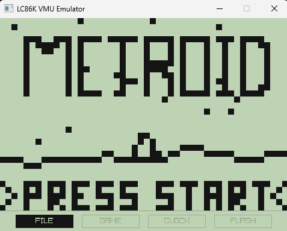
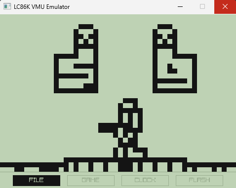
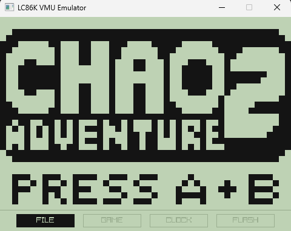
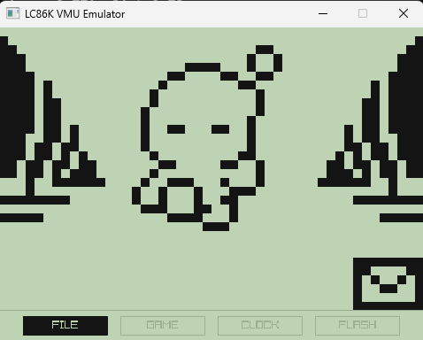

# LC86000

Émulateur du microcontrôleur **Sanyo LC86K87** (processeur 8-bit du Visual Memory Unit / VMU de la Sega Dreamcast), écrit en **Zig 0.16** avec rendu graphique et audio via **Raylib**.

---

## 🎮 Caractéristiques matérielles émulées

| Composant | Description |
|-----------|-------------|
| **CPU** | Sanyo LC86K87 8-bit, jeu complet de 70 instructions, adressages direct et indirect `@Ri` avec gestion multi-banques RAM (Bank 0 et Bank 1 / XRAM), gestion des drapeaux `CY`, `AC`, `OV`, `P`. |
| **Horloge** | Mode Standalone piloté par OCR (quartz 32.768 kHz / oscillation RC) ou mode Dreamcast connecté (6 MHz externe). |
| **Mémoire** | 512 octets de RAM interne (2 banques de 256 octets) + 198 octets de XRAM LCD (2×96 octets matrice + 6 octets icônes). |
| **ROM (BIOS)** | 64 Ko chargé en mémoire morte avec exécution authentique du boot et de toutes les phases officielles du BIOS. |
| **Flash (VMS)** | 128 Ko (200 blocs de 512 octets), système de fichiers FAT8 VMU authentique, injection et exécution des fichiers `.vms` et `.vmi`. |
| **Affichage** | Écran LCD monochrome 48×32 pixels, rendu XRAM réel à 60 FPS mis à l'échelle (×10), gestion du défilement matériel (`STAD`), gating (`MCR`/`VCCR`) et affichage des 4 icônes matérielles (`FILE`, `GAME`, `CLOCK`, `FLASH`). |
| **Audio** | Synthèse sonore PWM du buzzer VMU émulée via le Timer 1 et le flux audio Raylib. |
| **Entrées (P3)** | Port P3 active-low : D-Pad (Haut, Bas, Gauche, Droite), boutons A, B, MODE, SLEEP et synchronisation du latch d'entrée. |
| **Timers & IRQ** | Base Timer 14-bit (RTC à 32.768 kHz), Timer 0 (Mode 0 double 8-bit et Mode 2 16-bit auto-reload), Timer 1, gestion hiérarchique des interruptions. |

---

## 🕹️ Compatibilité

- **BIOS officiel** : Navigation complète et interactive (Horloge temps réel, Gestionnaire de fichiers Flash, Écran de réglage date et heure).
- **Mini-jeux VMU** : Démarrage direct ou lancement depuis le menu BIOS officiel (validé sur *Chao Adventure*, *Alien Fighter*, *Metroid*, etc.).

---

## 🚀 Utilisation

### Lancement

```bash
# Lancement direct via Zig
zig build run -- [options] [<jeu.vms>]

# Ou via l'exécutable compilé
./lc86K [options] [<jeu.vms>]
```

### Options en ligne de commande

| Option | Description |
|--------|-------------|
| `[<jeu.vms>]` | Fichier de mini-jeu VMS à installer en Flash (optionnel : sans jeu, démarre en mode autonome BIOS). |
| `[<bios.bin>] [<jeu.vms>]` | Spécifier un BIOS alternatif (par défaut : `roms/bios/vmu_bios_jp.bin`). |
| `--standalone` | Mode autonome par défaut : horloge pilotée par le quartz temps réel (OCR). |
| `--docked` | Mode connecté à la Dreamcast : horloge externe à 6 MHz. |
| `--bios-menu`, `-m` | Force l'ouverture du menu interactif de fichiers du BIOS même si un jeu est chargé. |
| `--set-time` | Démarre directement sur l'écran officiel de configuration de l'horloge et de la date. |
| `--azerty` | Active la disposition clavier AZERTY. |
| `--trace` | Active le traçage des SFR et lectures du port P3 sur `stderr`. |

### ⌨️ Contrôles

| Bouton VMU | Clavier QWERTY | Clavier AZERTY |
|------------|----------------|----------------|
| **D-Pad** | `Flèches` ou `W`, `A`, `S`, `D` | `Flèches` ou `Z`, `Q`, `S`, `D` |
| **Bouton A** (Valider / Action) | `Entrée`, `Espace`, `K`, `Z` | `Entrée`, `Espace`, `K`, `W` |
| **Bouton B** (Annuler / Retour) | `B`, `X`, `L`, `Retour arrière` | `B`, `X`, `L`, `Retour arrière` |
| **Bouton MODE** (Changer de vue) | `M`, `Tab` | `M`, `Tab` |
| **Bouton SLEEP** (Mise en veille) | `N` | `N` |
| **Soft Reset** (Retour menu BIOS) | `Échap`, `F1` | `Échap`, `F1` |

---

## 🏗️ Architecture du projet

Le projet est conçu pour être modulaire, lisible et facilement extensible :

| Fichier | Rôle |
|---------|------|
| [`lc86K.zig`](lc86K.zig) | **Cœur de l'émulateur** : définition de la structure `Cpu`, registres, mémoire (RAM, XRAM, ROM, Flash, SFR), gestion des interruptions et synchronisation des banques. |
| [`decode.zig`](decode.zig) | **Décodeur & Exécuteur** : lecture des opcodes, décodage des modes d'adressage, exécution (`step`), comptage des cycles CPU. |
| [`isa.zig`](isa.zig) | **Table ISA** : définition des 256 opcodes du processeur LC86K87 (mnémoniques, tailles, modes). |
| [`timer.zig`](timer.zig) | **Timers matériels** : Timer 0 (modes 0 et 2), Timer 1, Base Timer RTC (32.768 kHz). |
| [`vmu.zig`](vmu.zig) | **Périphérique VMU** : système de fichiers Flash FAT8, installateur/parseur de fichiers VMS/VMI, initialisation RTC du BIOS. |
| [`buzzer.zig`](buzzer.zig) | **Audio PWM** : générateur de forme d'onde sonore piloté par le Timer 1 via Raylib. |
| [`main.zig`](main.zig) | **Point d'entrée** : boucle d'émulation à 60 FPS (100 000 cycles par frame), gestion des événements clavier, rendu graphique Raylib. |
| [`debug.zig`](debug.zig) | **Outils de debug** : désassembleur à la volée, traçage des SFR et détection de boucles. |
| [`tests.zig`](tests.zig) | **Suite de tests unitaires** : 68 tests automatisés couvrant les instructions, timers, interruptions et exécution réelle de jeux. |

---

## 🛠️ Compilation & Tests

### Prérequis

- [Zig 0.16.0](https://ziglang.org/download/) (la version exacte requise pour les nouvelles API I/O `std.process.Init` et `std.Io.Dir`).
- Raylib est géré automatiquement par le gestionnaire de paquets de Zig (`build.zig.zon`).

### Commandes

```powershell
# Compiler en mode debug
zig build

# Compiler en mode optimisé (ReleaseFast)
zig build -Doptimize=ReleaseFast

# Exécuter la suite complète de tests unitaires
zig build test
```

Tous les tests unitaires (68/68) doivent passer sans avertissement.

---

## 📸 Visuels & Captures d'écran

### *Metroid*

| Écran titre | En jeu |
|:---:|:---:|
|  |  |

### *Chaos Adventure 2* (Sonic Adventure)

| Écran d'accueil | En jeu |
|:---:|:---:|
|  |  |

---

## 📚 Documentation technique de référence

Pour le développement et l'approfondissement matériel, se référer aux documents conservés dans [`doc/`](doc/) :
- [`doc/VMU.pdf`](doc/VMU.pdf) : Manuel matériel officiel de Sanyo / Sega (datasheet de référence absolue).
- [`doc/doc_inst.md`](doc/doc_inst.md) : Tableau complet des 70 instructions du LC86K, opcodes, modes d'adressage et drapeaux affectés.
- [`doc/doc_timer.md`](doc/doc_timer.md) : Spécification détaillée des modes de Timer 0, Timer 1 et du Base Timer.
- [`doc/bios.s`](doc/bios.s) : Désassemblage annoté de la ROM du BIOS officiel.
